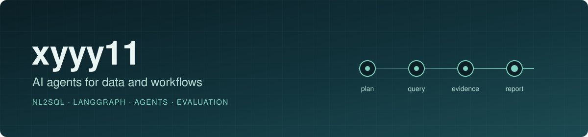
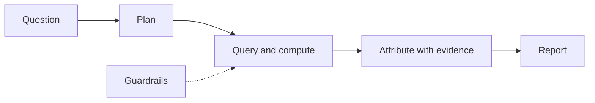

  

I build practical AI systems: agents that plan, query and report. I care most about the unglamorous parts — guardrails, evidence, and knowing when the data **cannot** support an answer.

## Featured projects

| Project | What it does | Stack |
|---|---|---|
| **[Data Intelligence Agent](https://github.com/xyyy11/data-intelligence-agent)** | Ask *"why did sales drop?"* in plain language and get SQL, attribution, charts and a written report. Includes NL2SQL behind a SQL guard and a CSV import engine for your own tables. | FastAPI · LangGraph · PostgreSQL · React · ECharts |
| **[Case Report Agent](https://github.com/xyyy11/case-report-agent)** | Collects sources, scores relevance, summarizes with an LLM and pushes a daily Markdown report to DingTalk / Feishu. Runs fully offline in dry-run mode. | Node.js · OpenAI API · Webhooks |

## How I approach agents

- **Guardrails first.** Model output is never trusted: generated SQL is validated before it reaches the database.
- **Evidence over eloquence.** A report should say which numbers moved, and say so plainly when the data is insufficient.
- **Runs on a fresh machine.** `.env.example`, one-command start-up, and an offline dry-run mode.

## Next up

- Evaluation harness for NL2SQL and attribution (execution accuracy, planted-anomaly ground truth)
- LLM-assisted planning versus rule-based planning: accuracy, latency, cost
- Embedding-based relevance ranking and faithfulness checks for summaries

Progress is tracked in each repository's roadmap.

中文：我做能解释数据、能落地交付的 AI Agent 项目。欢迎在项目的 Issues 里交流。
